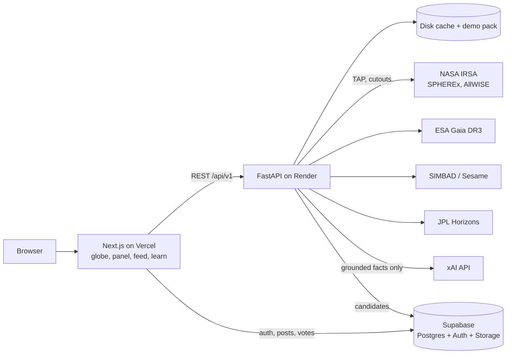

# SolaraX

**Find what moves in SPHEREx, and know what it is.**

A Google Earth for the changing sky, built on NASA's SPHEREx images. Spin a sky globe,
click any spot, and watch its SPHEREx images play as a timelapse so moving things stand
out. The app cleans out image junk, finds what moved, and uses SPHEREx's 102 colours to
say what it probably is. NASA Space Apps 2026 · Planet X and SPHEREx · Houston.

Three rules: call things **candidates, never discoveries**; **never show a number we
didn't fetch or measure** (anything else is marked PROPOSAL); no project code before
Sat Nov 14, 9 AM CT.

## Architecture



The browser never talks to IRSA, Gaia or xAI directly. Every outbound call has a
timeout and 3 retries (10/20/30 s); IRSA TAP falls back to async jobs when sync
queries stall. Cache keys include position, FOV and file version.

## Repo layout

| Path | What |
| --- | --- |
| `api/app/services/` | Science: `irsa_tap` (find exposures), `spherex_files` (open, zodi, version ≥ 7.0), `flags` (bits from headers), `align` (reproject, co-add), `render` (shared asinh stretch, difference, mask, GIF), `allwise` (deep-time frame + catalog), `gaia` (DR3 + proper-motion propagation), `detect`/`motion`/`clean`/`sources` (AI vision engine steps 1–2), `rules` (step 3, transparent scores), `spectrum`, `tutor` (grounded + number check) |
| `api/app/routers/v1.py` | REST endpoints (`/resolve`, `/targets`, `/images`, `/coverage`, `/cutouts`, `/baseline`, `/sources`, `/spectrum`, `/classify`, `/candidates`, `/tutor`, `/export/gif`, `/releases`, `/health`) |
| `api/config/targets.yaml` | Test targets. Only doc-sourced numbers; positions resolved live |
| `api/config/rules.yaml` | Class weights, thresholds, index windows, flag hide set (all PROPOSAL) |
| `api/scripts/precache.py` | Builds the demo pack from real runs |
| `api/scripts/check_releases.py` | Nightly SPHEREx release check |
| `api/tests/` | Unit tests, incl. the pipeline on synthetic SPHEREx-shaped FITS |
| `web/` | Next.js 15 app on the Nocturne design system (`web/app/nocturne.css`, from `mock-design/`) |
| `web/content/missions/` | Learn missions as data |
| `supabase/schema.sql` | Tables + row-level security |
| `docs/validation.md` | Validation table (fill from runs only) |

## Run it locally

```bash
# API (Python 3.12)
cd api
python -m venv .venv && .venv/Scripts/activate      # macOS/Linux: source .venv/bin/activate
pip install -r requirements.txt
cp .env.example .env                                  # optional: XAI_*, SUPABASE_*
python -m pytest -q
uvicorn app.main:app --port 8000

# Demo pack (real data for all test targets; needs IRSA up, takes a while)
python -m scripts.precache

# Web (Node 20+)
cd ../web
npm install
cp .env.example .env.local
npm run dev                                           # http://localhost:3000
```

## Status against the design doc

| Feature | State |
| --- | --- |
| 1 Sky globe | Aladin Lite v3 (SIN projection), search, target pins, coverage footprints when zoomed in, URL state |
| 2 Location panel + blink | Real pipeline: TAP → cutouts → zodi subtract → reproject to one grid → shared stretch → PNG; timelapse + A/B blink, keyboard, states |
| 3 Difference / stack / co-add / deep time | Inverse-variance co-add per pass, median/first difference, stack of ticked frames, RGB, AllWISE 2010 frame + catalog motion arrow |
| 4 Spectrum | Quick aperture photometry per exposure with spectral-WCS wavelengths; **not yet** ePSF fit, SAPM units or 102-channel binning (needs IRSA's channel table) |
| 5 Flags | Name→bit map from each header, hide set by name, nearest-neighbour mask reprojection, mask PNG |
| 6 Clean | Rules A (flags), C (too sharp), D (edges, streaks). Rule B and the CNN not built |
| 7 Detect | Per-pass detection, Gaia DR3 propagated match, AllWISE 2010 point, weighted motion fit, tags, ranking |
| 8 Classify | Transparent rule scores with parts from `rules.yaml`; neural model not built (rules decide) |
| 9 Hub / 10 Feed | Preview on Supabase (magic-link sign-in, votes with server-side weights, posts). ORCID not built |
| 11 Learn | Missions 1 and 3 runnable; mission 2 (Eros) waits on its demo-pack data |
| 12 Tutor | Fact sheet with IDs and sources, xAI call, number check, regenerate once, drop sentences |
| 13 Ask the sky / 14 Auto-report | Not built (preview items) |
| 15 Extras | URL state, `/embed` (framable only there), GIF export, demo pack, release cron |

**Not yet validated against live SPHEREx data**: IRSA's TAP service was returning
502s while this was built, so `/cutouts`, `/sources` and `/spectrum` have only run on
synthetic files in the tests. Column names were checked against IRSA's TAP schema.
First job on day 1: run `python -m scripts.precache wise0855` and check Checkpoint 1.

## Data and credits

- NASA SPHEREx via the NASA/IPAC Infrared Science Archive (IRSA). **TODO: paste IRSA's
  SPHEREx acknowledgement text here** (compliance item 8).
- NASA WISE / AllWISE via IRSA.
- ESA Gaia DR3 (partner data) via the ESA Gaia archive.
- SIMBAD and Aladin Lite (CDS, Strasbourg), JPL Horizons, Astropy, astroquery, photutils, reproject.
- No NASA logos. Not endorsed by NASA, ESA or CSA.

## AI disclosure

- In the app: the tutor's prose is generated by an xAI model from a fact sheet the app
  fetched or measured; numbers are checked and every claim cites a fact.
- In development: code written with AI assistance (Claude Code). Commits carry an
  AI co-author trailer.
